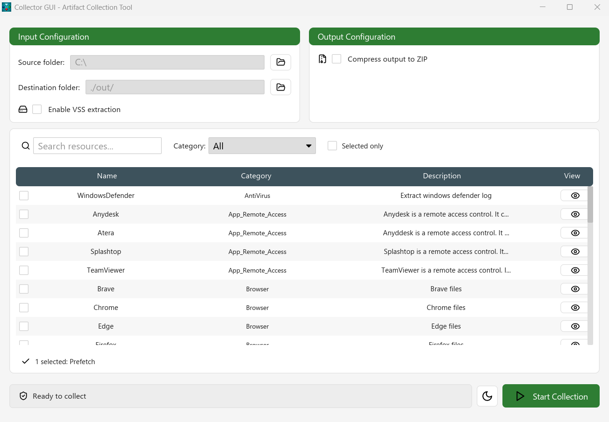
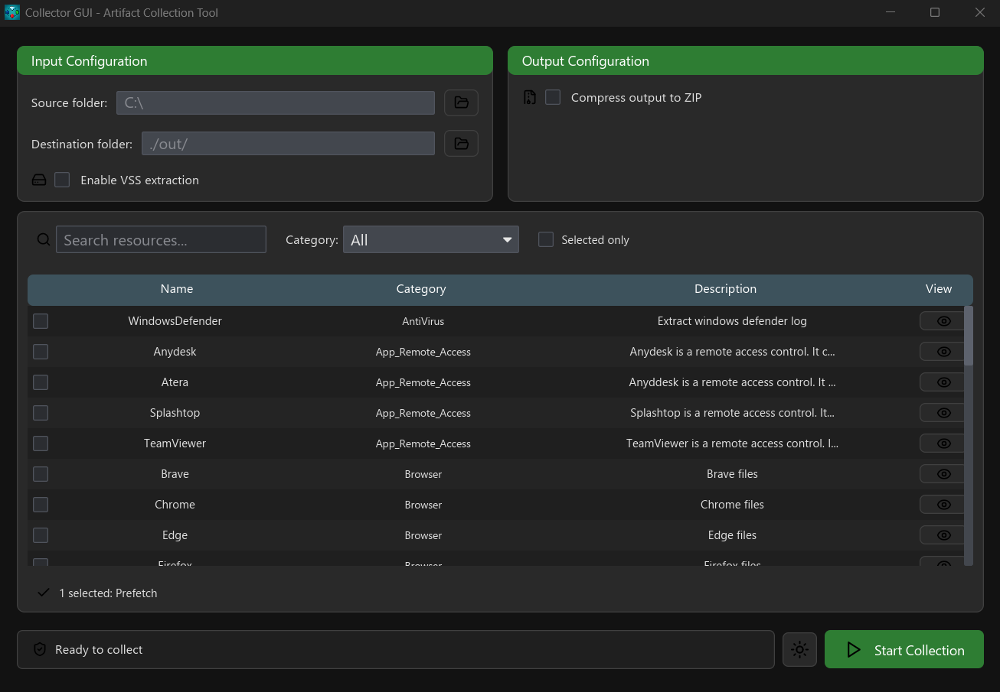

# Collector

This tool can collect different artifact on running system.
It collects data quickly and securely and is open source in Rust🦀.

## 🧩 How to use it (CLI Version)

To use this tool, you need to go to [release page](https://github.com/gems-ir/Collector/releases) of this project and donwload the lastest release.
After that, download the [resources](#resources) files to use it.
You can follow the [help command](#help_cmd) to personalize execution or you can run the binary as administrator on your computer.
Path exemple to use: 

```
./my_folder
 |-- collector_gui(.exe)
 |-- collector_cli(.exe)
 |-- collector_config_windows.toml
 |-- collector_config_linux.toml
 |-- Resources
        |-- AntiVirus
        |-- Browser
        |-- ...
```

## 🧩 GUI Version

| White mode                                                                 | Dark mode                                                                 |
| -------------------------------------------------------------------------- | ------------------------------------------------------------------------- |
|  |  |

## 📚Resources {#resources}

You can download the collection resources here: [https://github.com/gems-ir/Resources](https://github.com/gems-ir/Resources)

```bash
git clone https://github.com/gems-ir/Resources.git
```

## 🆘 Help command {#help_cmd}

```bash
This tool was an artefact collector fast and secure. It can collect low level files.
Usage: collector_cli.exe [OPTIONS] [COMMAND]
Commands:
  resources  Resource list options
  help       Print this message or the help of the given subcommand(s)
Options:
  -s, --source <SOURCE>
          The source path of collecting artifact [default: C:\]
  -d, --destination <DESTINATION>
          The destination path of collecting artifact [default: output\]
  -r, --resources <RESOURCES>
          Resources selection. You can list with "resources" command. Example: MFT,Prefetch,EVTX [default: All]
  -p, --path-resources <PATH_RESOURCES>
          Path to artifact resources [default: Resources\]
      --zip
          Zip the output directory
      --pass <PASS>
          Set zip password
      --vss
          Collect from vss. (Take more time)
  -c, --config <CONFIG>
          Use config file
      --log
          Print log output in terminal. (longer)
  -v, --verbose
          Verbose log
  -h, --help
          Print help
  -V, --version
          Print version
```

## 📦 Output

The collection is written to `Collector_<HOSTNAME>/` (or `Collector_<HOSTNAME>.zip` with
`--zip`, AES-256 with `--pass`). Collected files keep their original path, without the
drive colon (`C:\Windows\Prefetch\X.pf` → `C/Windows/Prefetch/X.pf`); files from VSS
snapshots are stored under the snapshot name (`HarddiskVolumeShadowCopy3/...`).

| File | Content |
| ---- | ------- |
| `Collector_copy.csv` | One row per copied file: `collect_time, source_file, destination_file, hash_sha1, from_ntfs, modified_time, access_time, file_size`. `modified_time` / `access_time` describe the **copy**, not the source file. Kept unchanged for compatibility. |
| `Collector_manifest.json` | Collection metadata and the list of collected files (see below). |

### `Collector_manifest.json` (version 1)

```json
{
  "manifest_version": 1,
  "tool": { "name": "gems-ir/Collector", "version": "0.4.0" },
  "host": { "hostname": "HOST01", "os_name": "Windows", "os_version": "11 (26100)",
            "long_os_version": "Windows 11 Pro", "kernel_version": "26100",
            "cpu_arch": "x86_64", "boot_time": "2026-10-15T07:12:03Z" },
  "collection": { "started_at": "2026-10-15T10:00:00.123Z", "finished_at": "2026-10-15T10:04:12.456Z",
                  "source": "C:\\", "resources": ["All"], "vss": true, "zip": true, "encrypted": true },
  "stats": { "files_collected": 1520, "bytes_collected": 734003200, "filesystem_extractions": 1490,
             "ntfs_extractions": 30, "failed_extractions": 2, "patterns_processed": 0 },
  "files": [
    { "source_path": "C:\\Windows\\Prefetch\\CMD.EXE-0BD30981.pf",
      "archive_path": "C/Windows/Prefetch/CMD.EXE-0BD30981.pf",
      "origin": "live", "vss_snapshot": null, "extraction": "filesystem",
      "size": 4210, "sha1": "…", "sha256": "…",
      "collected_at": "2026-10-15T10:00:01.002Z",
      "source_times": { "created": "2026-09-30T08:01:12.5Z", "modified": "2026-10-15T09:55:40.1Z",
                        "accessed": "2026-10-15T09:55:40.1Z" } }
  ],
  "files_count": 1520
}
```

- `source_times` are read on the **source** file before it is copied (`null` when the
  metadata cannot be read, e.g. NTFS metafiles such as `$MFT`; individual values are `null`
  when the platform does not provide them).
- All timestamps are RFC 3339, UTC. The ZIP password is never recorded, only `encrypted`.
- `origin` is `live` or `vss` (`vss_snapshot` then gives the snapshot name); `extraction`
  is `filesystem` or `ntfs` (raw NTFS read for locked files).

## 👨‍💻 Features

- [x] Low-level file collection
- [x] VSS (Collect from volume shadow copy on Windows)
- [x] Archive in ZIP format with a password
- [x] Embeded config file and resources into binary to execute in click and launch mode.
- [x] GUI
- [x] Collection manifest with SHA-256 and source timestamps
- [ ] Send to a remote server
- [ ] Adaptive collection
- [ ] Memory collection
- [ ] MacOS collection
- [ ] Android collection
- [ ] Create driver